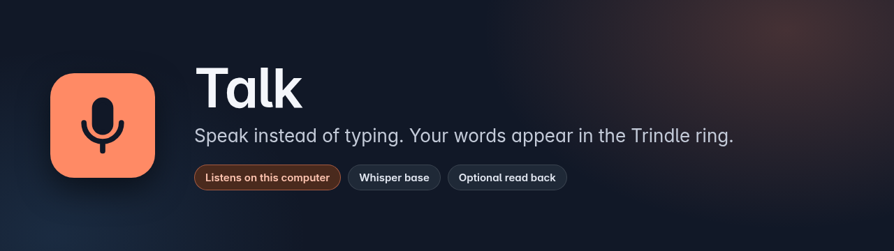
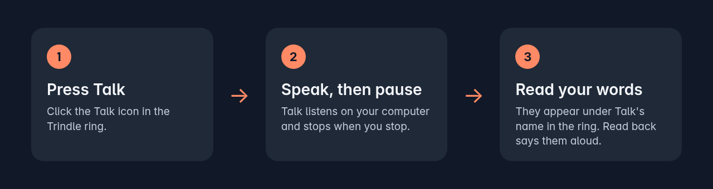

<p align="center">
  
</p>

<p align="center">
  
  
  
  
</p>

Talk is a Trindle plugin that lets you speak instead of typing. Press its icon in the ring, say what you want to write, and a moment later your words appear under Talk's name in the ring, with the ums and ers left out and British spelling if you like.

Listening and speaking both happen on your own computer. Speech recognition is Whisper base and the voice is Supertonic 2, both run by Trindle Voice. Nothing you say is sent anywhere.

## How it works

<p align="center">
  
</p>

## Quick start

Talk is installed from the Trindle Plugins page. To build the package yourself:

```sh
sh packaging/trindle-plugin.sh dist
```

This builds both programs, runs the tests and writes `dist/org.trindle.Talk/` and `dist/org.trindle.Talk.tar.zst`. The first time you press Talk it fetches its speech recognition (about 293 MB) into its own folder, which needs the network once. Turn on Read back and it fetches the voice (about 264 MB) the same way. After that Talk works offline. While it is working it needs about 1 GB of free memory.

## What it does

- Listens when you press Talk and stops when you pause.
- Takes out um, er and the rest, if you want.
- Changes American spellings to British ones, if you want.
- Understands 19 languages, or works out which one you are speaking.
- Reads your words back aloud in English, in a voice you choose.

The ring runs `talk ring`. `talk say WORDS` reads words aloud by hand, in the voice chosen in Settings.

## Settings

Talk has no window of its own. These are set on the Your plugins page.

| Setting | Default | What it does |
|---|---|---|
| Language you speak | Any language | The language to listen for. Any language lets Whisper decide. |
| Leave out um and er | On | Removes filler words from what was heard. |
| British spelling | On | Puts American spellings into British ones. |
| Read back what Talk heard | Off | Says your words aloud once they are heard. |
| Reading voice | Male 5 | Which of the ten Supertonic voices reads back. Shown when Read back is on. |

## Where your data lives

Talk keeps its settings and the latest status in its own plugin folder. The speech recognition and voice files are kept in the Trindle voice folder, `~/.local/share/trindle/voice`. Your voice is processed as it comes in and the audio is not written to disk. The words Talk heard are kept as lines in `notify.jsonl` in the plugin folder, and the oldest are trimmed.

## Security

Talk asks for four permissions and you choose which to allow: the microphone (to hear you), sound (to read back), the network (to fetch the speech files once) and notifications (to show your words). Downloaded files are checked against pinned checksums. See [SECURITY.md](SECURITY.md) for how to report a problem.

## Building it yourself

Talk needs Rust 1.93 or newer (Debian 13's 1.85 is too old), edition 2024.

```sh
cargo build --release
cargo test --release
cd trindle-voice && cargo test --release
```

`packaging/trindle-plugin.sh` builds the plugin folder and its archive. It builds both programs with no path from the build computer inside them, into `target/shipped/`. `tools/licences.sh` writes the third-party notices for the Rust packages and the models to `trindle-voice/licences/THIRD-PARTY.txt`.

`trindle-voice/` is a folder in this repository: Talk's own program that listens and speaks, through two doors, `voice-hear` and `voice-say`. It uses the speech engine from the separate [Trindle Voice](https://github.com/trindle-os/trindle-voice) repository, pinned to one commit in `trindle-voice/Cargo.toml`. The general speech service for other programs, such as the screen reader, is in Trindle Voice, not in Talk. When Trindle's system image installs that service, Talk reads your words back through it and looks for the voice files in `/usr/share/trindle-voice` before its own folder; without it, Talk starts its own copy of the program.

To check it by hand, the `trindle-voice` program has four commands:

- `--list` prints what there is to download.
- `--wav FILE [VOICE] WORDS` writes the spoken words to a WAV file.
- `--hear-wav FILE [LANGUAGE]` prints the words heard in a 16 kHz mono WAV file.
- `--fetch hearing|supertonic|VOICE` downloads and checks that part.

## Licence

Talk is released by the Trindle project under the GNU General Public License, version 3 or later. The full text is in [LICENSE](LICENSE), and changes are listed in [CHANGELOG.md](CHANGELOG.md). Licences of the Rust packages and the models are in `trindle-voice/licences/`. The Supertonic voice files carry the Open RAIL-M use restrictions.

To report a bug or ask a question, go to [trindle.buildmorphic.com](https://trindle.buildmorphic.com) or see [CONTRIBUTING.md](CONTRIBUTING.md).

Comments are stripped from the published code to keep it lean.

## Disclaimer

Talk is provided as it is, without any warranty. Speech recognition makes mistakes, so check what it heard before you rely on it.
